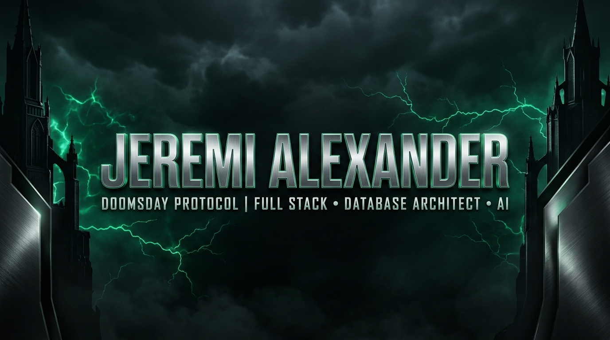
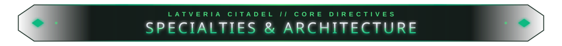
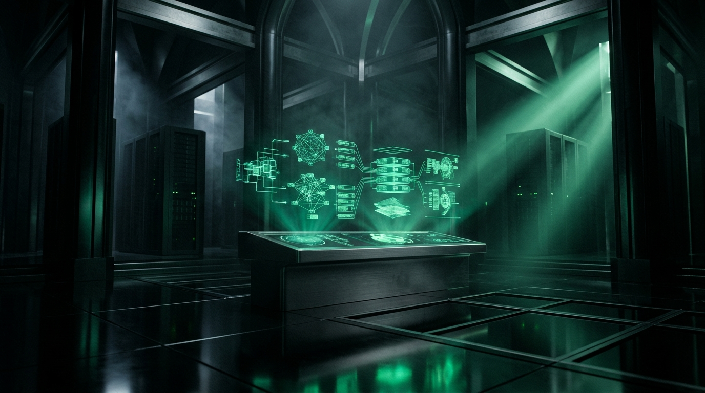
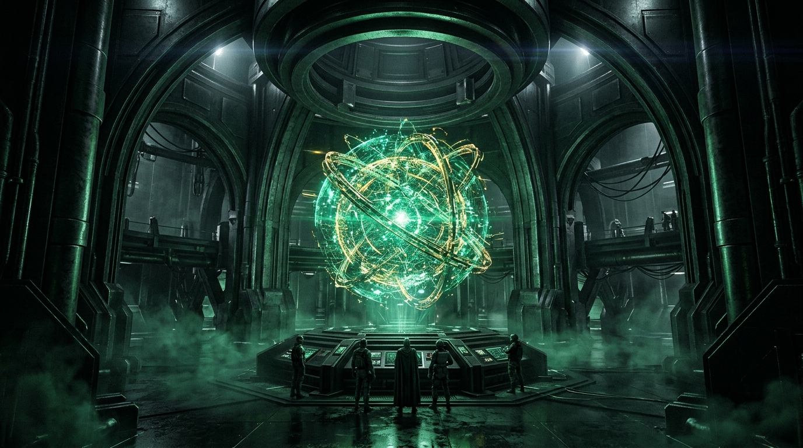
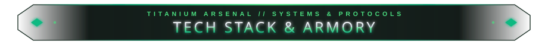
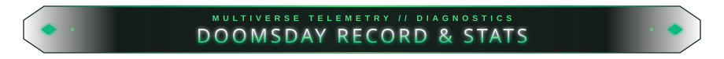
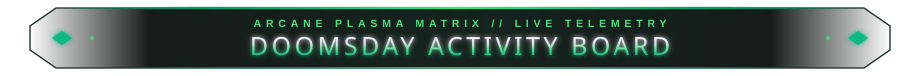
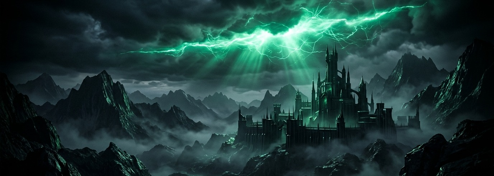

<!-- ===================== AVENGERS: DOOMSDAY HERO BANNER ===================== -->

  

 

  

 

<!-- ===================== LATVERIA COMMS CTA BUTTONS ===================== -->

  
  
  
  

 

<!-- ===================== INTERACTIVE NAVIGATION HUD ===================== -->

  &nbsp;
  &nbsp;
  &nbsp;
  

 

<!-- ===================== ARCANE EMERALD DIVIDER ===================== -->

 

<!-- ===================== SPECIALTIES (REALISTIC DOOMSDAY CARDS) ===================== -->

  

 

  <table>
    <tr>
      <td align="center" width="300">
        
          
        <h4><code>BACKEND ENGINEERING</code></h4>
        
<b>Java · Spring · Node.js</b> APIs · Arquitectura · Patrones

        
      </td>
      <td align="center" width="300">
        
          
        <h4><code>DATABASE ARCHITECTURE</code></h4>
        
<b>SQL Server · Oracle · PostgreSQL</b> Modelado · SPs · Optimización

        
      </td>
      <td align="center" width="300">
        
          
        <h4><code>AI &amp; DEVOPS OPS</code></h4>
        
<b>Docker · Cloud · Automatización</b> ML Basics · Integraciones

        
      </td>
    </tr>
  </table>

 

 

<!-- ===================== TECH STACK (TITANIUM ARMORY) ===================== -->

  

 

<!-- =============== FRONTEND =============== -->

  

    
  

   
  

    <table>
      <tr>
        <td align="center" width="110">
          
           <code>React</code>
        </td>
        <td align="center" width="110">
          
           <code>Next.js</code>
        </td>
        <td align="center" width="110">
          
           <code>Angular</code>
        </td>
        <td align="center" width="110">
          
           <code>Vue</code>
        </td>
        <td align="center" width="110">
          
           <code>TypeScript</code>
        </td>
        <td align="center" width="110">
          
           <code>JavaScript</code>
        </td>
      </tr>
      <tr>
        <td align="center" width="110">
          
           <code>Tailwind</code>
        </td>
        <td align="center" width="110">
          
           <code>Bootstrap</code>
        </td>
        <td align="center" width="110">
          
           <code>HTML5</code>
        </td>
        <td align="center" width="110">
          
           <code>CSS3</code>
        </td>
        <td align="center" width="110">
          
           <code>Sass</code>
        </td>
        <td align="center" width="110">
          
           <code>Figma</code>
        </td>
      </tr>
    </table>
  

 

<!-- =============== BACKEND =============== -->

  

    
  

   
  

    <table>
      <tr>
        <td align="center" width="110">
          
           <code>Java</code>
        </td>
        <td align="center" width="110">
          
           <code>Spring</code>
        </td>
        <td align="center" width="110">
          
           <code>Node.js</code>
        </td>
        <td align="center" width="110">
          
           <code>Express</code>
        </td>
        <td align="center" width="110">
          
           <code>Python</code>
        </td>
        <td align="center" width="110">
          
           <code>C#</code>
        </td>
      </tr>
      <tr>
        <td align="center" width="110">
          
           <code>.NET</code>
        </td>
        <td align="center" width="110">
          
           <code>PHP</code>
        </td>
        <td align="center" width="110">
          
           <code>Postman</code>
        </td>
        <td align="center" width="110">
          
           <code>IntelliJ</code>
        </td>
        <td align="center" width="110">
          
           <code>VS Code</code>
        </td>
        <td align="center" width="110">
          
           <code>Git</code>
        </td>
      </tr>
    </table>
  

 

<!-- =============== DATABASES & CLOUD =============== -->

  

    
  

   
  

    <table>
      <tr>
        <td align="center" width="110">
          
           <code>MySQL</code>
        </td>
        <td align="center" width="110">
          
           <code>PostgreSQL</code>
        </td>
        <td align="center" width="110">
          
           <code>MongoDB</code>
        </td>
        <td align="center" width="110">
          
           <code>Oracle</code>
        </td>
        <td align="center" width="110">
          
           <code>SQL Server</code>
        </td>
        <td align="center" width="110">
          
           <code>Redis</code>
        </td>
      </tr>
      <tr>
        <td align="center" width="110">
          
           <code>Firebase</code>
        </td>
        <td align="center" width="110">
          
           <code>Docker</code>
        </td>
        <td align="center" width="110">
          
           <code>Kubernetes</code>
        </td>
        <td align="center" width="110">
          
           <code>AWS</code>
        </td>
        <td align="center" width="110">
          
           <code>Azure</code>
        </td>
        <td align="center" width="110">
          
           <code>GitHub</code>
        </td>
      </tr>
    </table>
  

 

 

<!-- ===================== AVENGERS: DOOMSDAY GITHUB STATS ===================== -->

  

 

  
  

  

 

 

<!-- ===================== DOOMSDAY PLASMA ACTIVITY MATRIX ===================== -->

  

 

  

 

<!-- ===================== LATVERIA CITADEL NIGHT FOOTER ===================== -->

  

